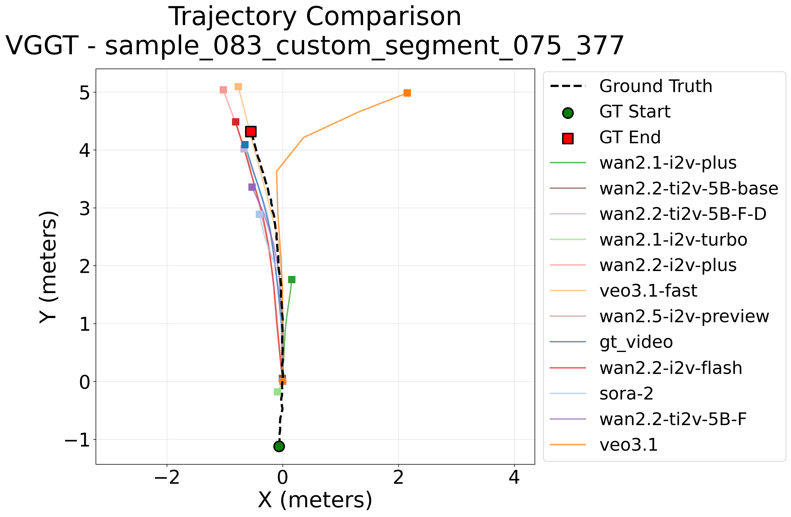

<div align="center">

</div>

<h1 align="center">Target-Bench:</h1>
<h3 align="center">Can World Models Achieve Mapless Path Planning with Semantic Targets?</h3>

<div align='center'>

If you find our work useful, please give us a star ⭐! Your support drives us to keep improving.


🎯 [Project Page](https://target-bench.github.io/) • 📄 [Paper](https://target-bench.github.io/resources/TargetBench.pdf) • 🤗 [Dataset](https://huggingface.co/target-bench) 


<br/>

</div>

[**TL;DR**] Target-Bench is the first benchmark and dataset for evaluating video world models (WMs) on mapless robotic path planning for semantic targets.


## TODO &#128203;<a name="todo"></a>
- [x] Fine-tuned checkpoints release
- [x] Fine-tune code release
- [x] Benchmark code release
- [x] Dataset release
- [x] Paper release
- [x] Website launch

## News
- **[2026.01]** We release the training code for fine-tuning world models!
- **[2025.11]** We release the [Paper](https://target-bench.github.io/resources/TargetBench.pdf), [Dataset](https://huggingface.co/target-bench), and [Benchmark Code](https://github.com/TUM-AVS/target-bench)!

## Table of Contents
- [Installation](#installation)
  - [Clone the repository](#1-clone-the-repository)
  - [Evaluation Environment Setup](#2-evaluation-environment-setup)
  - [Dataset Download](#3-dataset-download)
- [Evaluation](#evaluation)
  - [Quick Evaluate with VGGT](#quick-evaluate-with-vggt)
  - [Evaluation Result Visualization](#evaluation-result-visualization)
- [Fine-tune](#fine-tune)
  - [Fine-tune Environment Setup](#1-fine-tune-environment-setup)
  - [Checkpoint Download](#2-checkpoint-download)
  - [Prepare Inference & Fine-tune Dataset](#3-prepare-inference--fine-tune-dataset)
  - [Inference with Fine-tuned Checkpoint](#4-inference-with-fine-tuned-checkpoint)
  - [Fine-tune with LoRA](#5-fine-tune-with-lora)
- [Citation](#citation)

## Installation

### 1. Clone the repository

```bash
git clone https://github.com/TUM-AVS/target-bench.git
cd target-bench
```

### 2. Evaluation Environment Setup

Ensure you have [miniconda](https://docs.anaconda.com/free/miniconda/miniconda-install/) installed.

You can set up all environments at once or individually. For a quick start with VGGT:

```bash
# Install VGGT environment
bash set_env.sh vggt
```

For other options (installing all environments or specific ones like SpaTracker/ViPE), please refer to [docs/env.md](docs/env.md).

### 3. Dataset Download

Download the `benchmark_data` (scenarios) and `wm_videos` (generated videos) into the `dataset/` directory:

```bash
cd dataset

# Download Benchmark scenarios
huggingface-cli download target-bench/benchmark_data --repo-type dataset --local-dir Benchmark --local-dir-use-symlinks False

# Download World Model generated videos
huggingface-cli download target-bench/wm_videos --repo-type dataset --local-dir wm_videos --local-dir-use-symlinks False

cd ..
```

Now, the project directory structure should look like this:

```text
target-bench/
├── DiffSynth-Studio/        # DiffSynth-Studio for fine-tuning
├── assets/                  # Images and project assets
├── dataset/                 # Benchmark data and generated videos
│   ├── Benchmark/           # Benchmark scenarios
│   └── wm_videos/           # Videos generated by world models
├── evaluation/              # Evaluation scripts and configs
├── models/                  # Source code for evaluated models
│   ├── spatracker/
│   ├── vggt/
│   └── vipe/
└── pipelines/               # World decoders adapted for each model
    ├── spatracker/
    ├── vggt/
    └── vipe/
```

## Evaluation
### Quick Evaluate with VGGT
Run a quick evaluation with 3 scenes using VGGT as the spatial-temporal tool:
```bash
conda activate vggt
cd evaluation
python target_eval_vggt.py -n 3 
```
### Evaluation Result Visualization
Then you should be able to see the evaluation results and visualizations in the `evaluation_results` folder: 
<div align="center">

</div>

## Fine-tune

### 1. Fine-tune Environment Setup

```bash
conda deactivate
conda create -n target-finetune python=3.10 -y
conda activate target-finetune
cd DiffSynth-Studio
pip install -r requirements.txt
```

### 2. Checkpoint Download
```bash
cd DiffSynth-Studio/models/train
# Download Fine-tuned Checkpoint
huggingface-cli download target-bench/ckpts --repo-type model --local-dir ckpts --local-dir-use-symlinks False
cd ../..
```

### 3. Prepare Inference & Fine-tune Dataset
```bash
huggingface-cli download target-bench/finetune_dataset --repo-type dataset --local-dir dataset --local-dir-use-symlinks False
cd dataset
# data_four_segments_121_frames.zip contains the data augmentation result
unzip data_four_segments_121_frames.zip data_single_segment_121_frames.zip data_inference.zip
cd ..
```

### 4. Inference with Fine-tuned Checkpoint
Inference with Checkpoint finetuned using data augmentation.
```bash
python run_inference_four_segments_epoch-49_batch.py
```

### 5. Fine-tune with LoRA
Fine-tune Wan2.2-TI2V-5B on 325 scenarios using data augmentation result.
```bash
bash Wan2.2-TI2V-5B_four_segments.sh
```

## Citation

```bibtex
@article{wang2025target,
  title={Target-Bench: Can World Models Achieve Mapless Path Planning with Semantic Targets?},
  author={Wang, Dingrui and Ye, Hongyuan and Liang, Zhihao and Sun, Zhexiao and Lu, Zhaowei and Zhang, Yuchen and Zhao, Yuyu and Gao, Yuan and Seegert, Marvin and Sch{\"a}fer, Finn and others},
  journal={arXiv preprint arXiv:2511.17792},
  year={2025}
}
```

## Credits

This project builds upon the following open-source works:
- **[VGGT](https://github.com/facebookresearch/vggt)**
- **[ViPE](https://github.com/nv-tlabs/vipe)**
- **[SpatialTrackerV2](https://github.com/henry123-boy/SpaTrackerV2)**
- **[DiffSynth-Studio](https://github.com/modelscope/DiffSynth-Studio)**

Please refer to their respective directories for detailed credits and license information.
